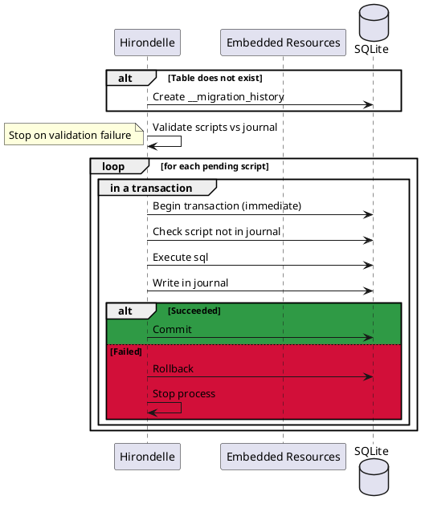

# Analysis

## API

```csharp
using Hirondelle

connection.Migrate(typeof(Program).Assembly);
```

## Embedded resources

### Resource names

The following kinds of names will be supported
```
1.0.0_create_tables.sql
1.1.0_add_users.sql
1.1.0.1_seed_users.sql
1.2.0_add_index.sql
```

```regex
^(?<version>\d+\.\d+\.\d+(?:\.\d+)?)(?:[_-](?<name>[^.\s]+))?\.sql\z
```
### Resource management

Create a `.targets` file in a `build/` folder at the root of the project

```xml
<Project>
  <PropertyGroup>
    <HirondelleFolder Condition="'$(HirondelleFolder)' == ''">Migrations</HirondelleFolder>
    <HirondelleAutoEmbed Condition="'$(HirondelleAutoEmbed)' == ''">true</HirondelleAutoEmbed>
  </PropertyGroup>
  <ItemGroup Condition="'$(HirondelleAutoEmbed)' == 'true'">
    <EmbeddedResource Remove="$(HirondelleFolder)\**\*.sql" />
    <EmbeddedResource Include="$(HirondelleFolder)\**\*.sql"
                      LogicalName="Hirondelle/%(RecursiveDir)%(Filename)%(Extension)" />
  </ItemGroup>
</Project>
```

> I create a `HirondelleFolder` condition whose default value is `Migrations`. Users can change this name by adding a `PropertyGroup` to their `csproj` containing
> `<HirondelleFolder>Database\Scripts</HirondelleFolder>`

| Variable              | Definition                                          |
| --------------------- | --------------------------------------------------- |
| `HirondelleFolder`    | Source folder of the migration scripts              |
| `HirondelleAutoEmbed` | Automatically embeds the scripts of the source folder |

Then add to `Hirondelle.csproj`:

```xml
<ItemGroup>
  <None Update="build\Hirondelle.targets"
        Pack="true"
        PackagePath="build\;buildTransitive\" />
</ItemGroup>
```

## The SQLite database

```sql
create table __migration_history (
    script     text not null primary key,
    applied_at text default (strftime('%Y-%m-%dT%H:%M:%fZ', 'now')),
    sha256     text not null
);
```

# Process



## Hash rules

| State       | Resource | Version      | Hash      | Action  |
| ----------- | -------- | ------------ | --------- | ------- |
| Applied     | Present  |              | Identical | Skip    |
| Applied     | Present  |              | Different | Error   |
| Applied     | Missing  |              |           | Error   |
| Not applied | Present  | script > DB  |           | Execute |
| Not applied | Present  | script < DB  |           | Error   |

> [!Warning] Error handling
There are still two errors to handle
>* When a script has an invalid name
>* When a script has a duplicate

## Transaction management

```csharp
foreach (var script in pending)
{
    using var tx = connection.BeginTransaction();          // BEGIN IMMEDIATE

    if (IsInJournal(connection, tx, script.Name))          // applied in the meantime
        continue;                                          // Dispose → rollback

    Execute(connection, tx, script.Content);               // exception → rollback, stop
    InsertJournal(connection, tx, script.Name, script.Sha256);

    tx.Commit();
    applied.Add(script.Name);
}
```

